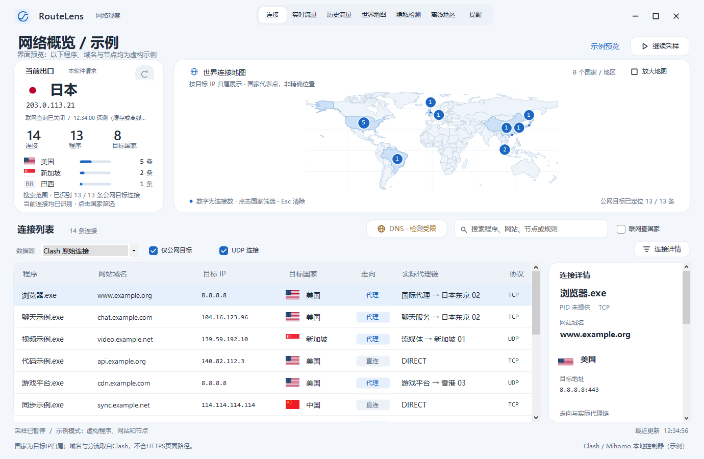
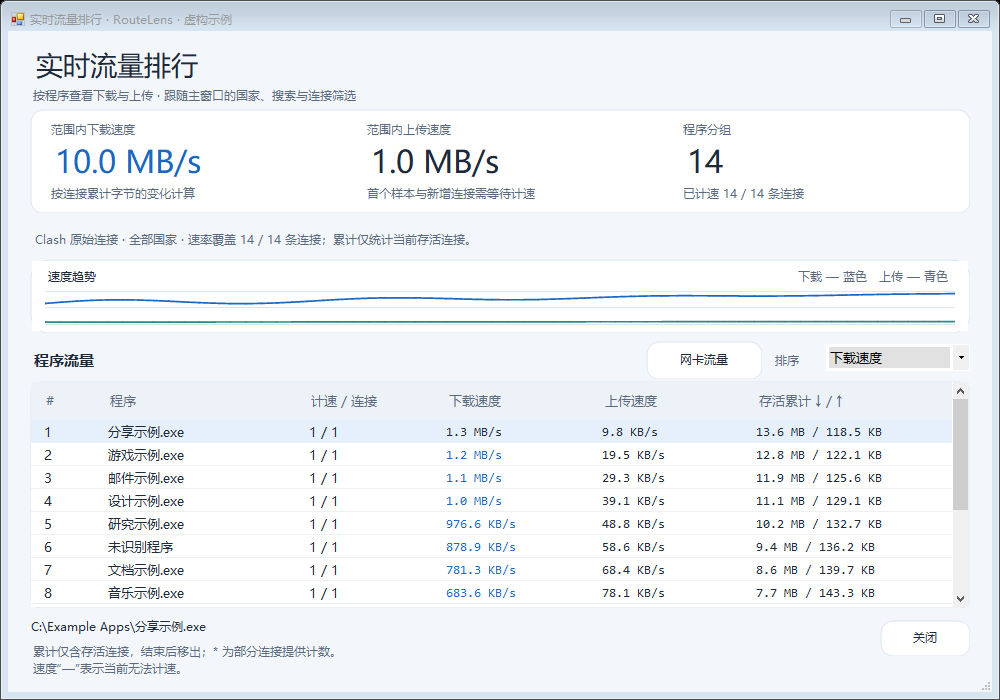
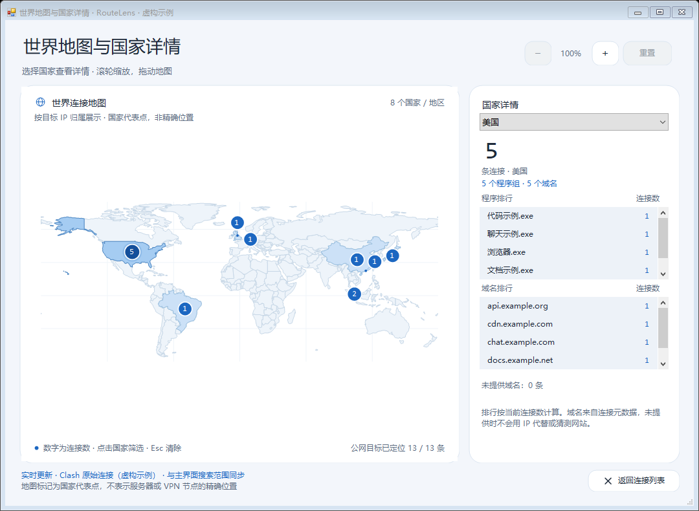

# RouteLens

RouteLens 是一款开源 Windows 网络观察工具。从 Clash / Mihomo 读取活动连接，在一个界面中查看程序、域名、目标地区、实际代理链和流量变化，并提供地图、DNS 检测与可选的本地历史记录。

RouteLens is an open-source Windows network monitor for Clash / Mihomo, with connection and traffic views, a world map, DNS checks, and optional local history.

## 下载与运行

需要 **Windows 10/11 和 .NET Framework 4.8**。前往 [最新版本下载页](https://github.com/0d000721inme/RouteLens/releases/latest)，下载 `RouteLens-Windows-v7.zip`，解压后双击 `RouteLens.exe`；也可以下载 [单文件程序](https://github.com/0d000721inme/RouteLens/releases/download/v7.0.0/RouteLens.exe)。无需 Python、Node.js 或抓包驱动。

保持 Clash / Mihomo 运行，RouteLens 会尝试发现本机控制接口。普通权限可以使用连接、地图和流量视图；DNS 被动捕获需要管理员权限，权限不足时会标注检测受限。

## 功能

- **原始连接**：查看内核提供的程序、域名、目标 IP、国家或地区、代理链和命中规则；也可切换到 Windows 系统连接视图。
- **实时流量**：查看 Clash 活动连接的程序排行与速度趋势；另可查看各网卡独立的上下行速度。
- **历史流量**：可主动开启本机记录，按程序、域名、代理链或最终节点汇总，选择保留 7、30 或 90 天并清除记录。默认不记录历史。
- **世界地图**：查看目标 IP 的国家分布，在地图详情窗口缩放、拖动，并按国家查看程序和域名排行。
- **离线国家识别**：内置 DB-IP Country Lite 数据库；支持主动下载更新或导入国家版 CSV / CSV.GZ。无离线结果时可选择是否联网查询。
- **DNS 检测**：被动观察物理 IPv4 网卡上的明文 DNS 外发；也可以手动启动主动测试，查看测试服务观察到的解析服务器与请求出口。
- **联网提醒**：可选提醒新程序、新目标地区或 Clash 流量达到设定阈值；默认关闭，仅本次运行有效。

界面截图使用虚构程序、域名与节点：







## 数据与能力范围

程序、域名和代理链来自 Clash 的本机接口，能否识别取决于内核提供的元数据；HTTPS 完整网址、页面内容或浏览器标签页无法从连接表直接获得。未经过该内核的连接可切换到 Windows 视图查看，但系统连接表无法从代理隧道还原原始网站，也不提供逐连接流量。

实时速度和历史流量来自 Clash 活动连接累计字节的连续采样差值；短连接可能遗漏，不代表整机或计费流量。网卡窗口显示每张接口的独立速度，不将虚拟、隧道与物理网卡相加以免重复计算，也不能归因到程序。地图采用国家级代表点，不能视为服务器精确位置或 VPN 出口实测位置。

被动 DNS 检查只覆盖物理 IPv4 接口上的明文 DNS，不覆盖 IPv6、DoH、DoT 等路径；主动测试只反映测试请求自身的路径。未观察到异常不等于不存在泄露，解析服务器与出口的地区不同也不足以单独证明泄露。详细说明见 [使用说明](使用说明.md)。

离线查询在本机完成。启用联网国家查询时，未能离线识别的公网 IP 可能发送给查询服务；出口探测和缺少的旗帜也可能访问相应服务。主动 DNS 测试只在用户点击开始后联系第三方服务，它能看到该测试的请求出口 IP 和解析服务器；不会发送浏览历史。历史记录包含程序、域名与代理链，仅在用户启用后保存在本机 `data/`。

## 从源码构建

项目使用 C#、WinForms 与 .NET Framework，不需要 NuGet 包。在 Windows PowerShell 中从仓库根目录运行：

```powershell
.\build.ps1
```

脚本调用 Windows 的 .NET Framework 编译器，将地图、旗帜与 `resources/dbip-country-lite.csv.gz` 内嵌到根目录的 `RouteLens.exe`。本地历史功能使用 Windows 自带的 SQLite 接口；发行包包含程序，个人 `data/` 不应包含在公开发布内容中。

相关检查使用虚构数据，不连接 Clash 或主动 DNS 服务：

```powershell
.\tests\RunTrafficTrackerChecks.ps1
.\tests\RunHistoryChecks.ps1
.\tests\RunOfflineChecks.ps1
.\tests\RunPrivacyChecks.ps1
.\tests\RunActivityAlertsChecks.ps1
.\tests\RunSystemTrafficChecks.ps1
```

## 许可证

RouteLens 源码采用 [MIT License](LICENSE)，允许使用、修改和分发；分发时请保留许可证与版权声明。界面参考、离线数据库、地图与旗帜等第三方资源保留各自的许可，来源和归属见 [THIRD_PARTY_NOTICES.md](THIRD_PARTY_NOTICES.md)。
