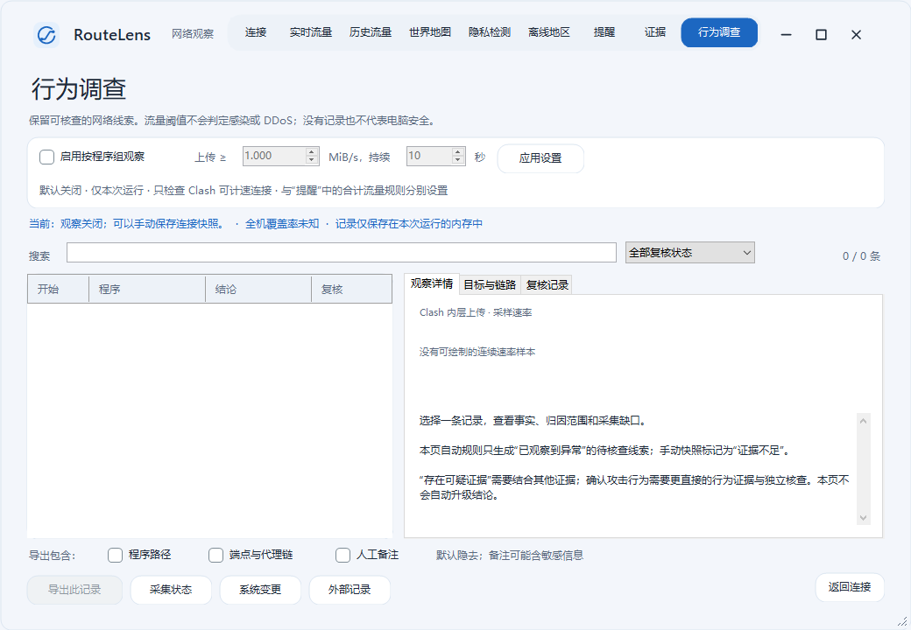

# 主窗口缩放与圆角

v7.2.1 修复 v7.2.0 右下角实际拖拽不改变窗口尺寸的问题。上一版虽然能返回正确的缩放命中值，但没有为 HWND 启用 WS_THICKFRAME；原有测试只验证命中和程序设置尺寸，未覆盖 Windows 的实际缩放循环。

## 实现

- HWND 启用原生 WS_THICKFRAME，鼠标拖动进入 Windows 的缩放循环，使用系统捕获和最小尺寸约束。
- WinForms 的 CreateParams 保留无边框布局计算，原生样式在句柄创建后设置；WM_NCCALCSIZE 让客户区占满窗口。这样避免标准边框补偿导致初次显示或最大化还原后尺寸漂移。样式更新时重新确认原生缩放标志。
- 普通窗口四周保留 8 DIP 的缩放边带，四边和四角返回对应的命中值。右下角另有可见的 24×24 DIP 拖拽柄，不必精确点中圆角最外侧几像素；位置随客户区尺寸同步更新。
- 拖拽柄将真实鼠标按下交给主窗口的原生缩放处理，不自行模拟尺寸变化。最大化时隐藏拖拽柄，去掉圆角与外层留白。
- 圆角半径 12 DIP；更新后释放旧 Region。最大化使用当前显示器工作区，还原保留位置与尺寸。
- 默认最小尺寸 1040×720，按系统 DPI 调整；首次显示以当前屏幕工作区为限。项目仍是系统 DPI 感知，没有完成混合 DPI 的逐显示器重排。

## 验证

RunWindowChromeChecks.ps1 覆盖九页八方向、实际坐标对应 HWND、拖拽柄位置和遮挡、原生样式、最小尺寸、圆角、连续最大化/还原及最小化/还原。只向父窗口发送命中消息不能证明实际拖动有效。

RunWindowResizeInteractionChecks.ps1 编译独立交互检查程序，禁用真实网络采集。程序只观察鼠标触发的非客户区按下、系统缩放命令、进入/退出及尺寸变化；启动后不通过设置 Bounds 模拟拖拽成功。标题和状态区显示尺寸、拖拽柄位置、鼠标坐标及原生样式。

2026-11-03 Windows 10（19045）实际鼠标验证：

- 右下角向内拖动：1180×780 → 1100×740。
- 同一窗口向外拖动：1100×740 → 1115×755。
- 再次向内拖动：1115×755 → 1076×735。
- 右边缘水平拖动：1076×735 → 1058×735。
- 四次均记录对应的 WM_SYSCOMMAND/SC_SIZE、WM_ENTERSIZEMOVE、WM_SIZING 和 WM_EXITSIZEMOVE。

桌面截图捕获仍不可用；实际拖动使用桌面输入工具，结果通过应用可访问性状态读取。工具在缩放后沿用初始坐标比例，依据测试窗口报告的实际鼠标位置修正了后续输入坐标。原生 DrawToBitmap 截图另外用于检查布局，不把它当作鼠标交互证据。Windows 11 与混合 DPI 多显示器尚未实机验证。

